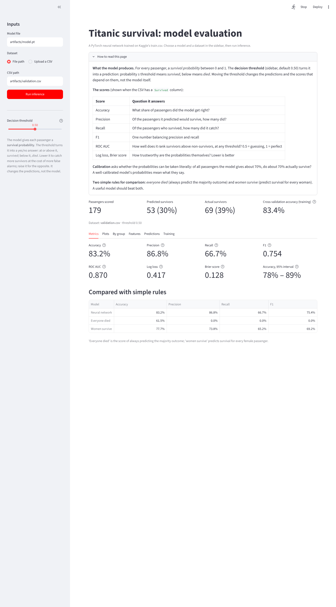
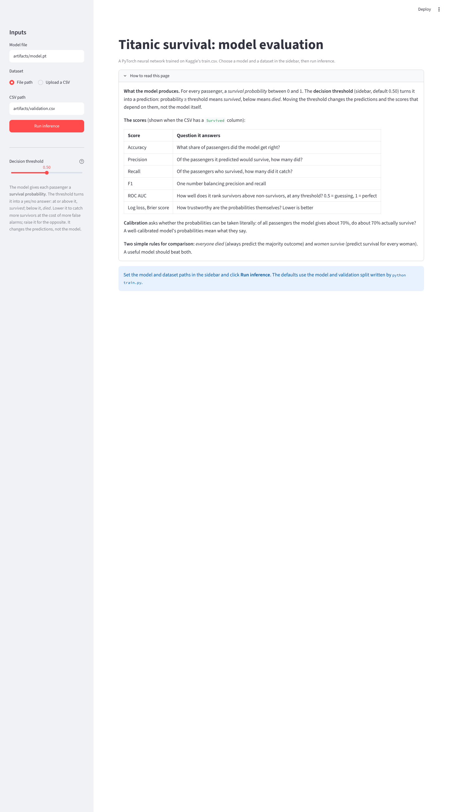
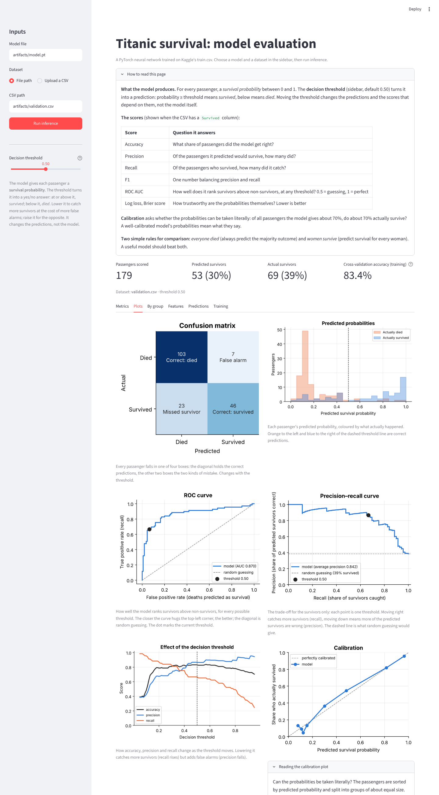
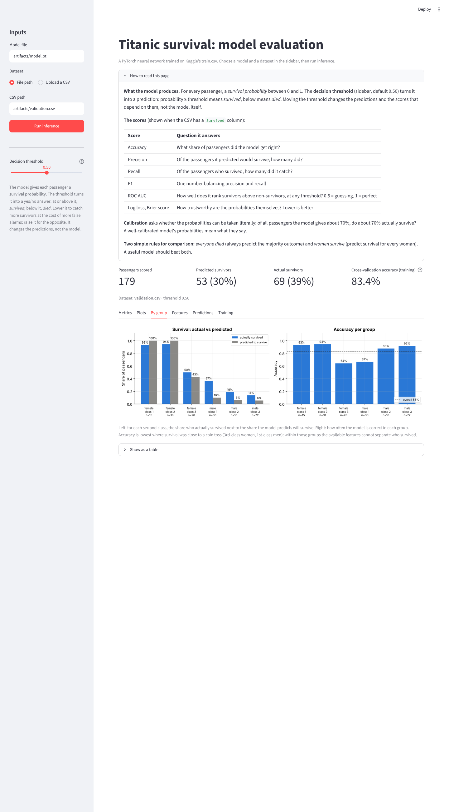
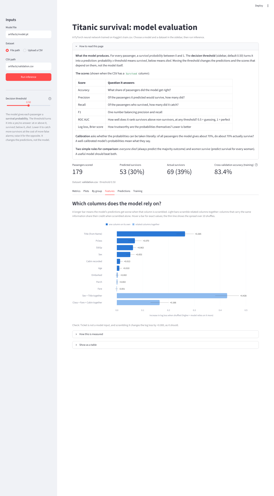
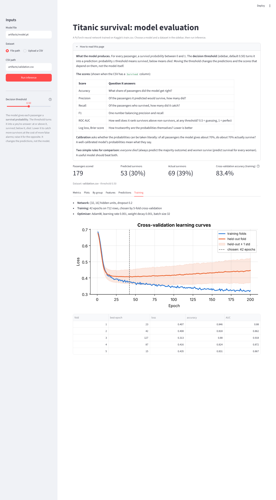

# Titanic survival: PyTorch classifier with a Streamlit evaluation app

An end-to-end classification pipeline for the Kaggle Titanic competition: data fetched from Kaggle in code, exploratory analysis in a notebook, preprocessing derived from that analysis, a PyTorch neural network trained by a standalone script, and a Streamlit app that loads the saved model, scores any Titanic-format CSV and shows metrics and plots.

Only Kaggle's `train.csv` is used. It is split once into a training part (712 passengers) and a held-out validation part (179 passengers); `test.csv` and `gender_submission.csv` are never touched.

| | Accuracy | ROC AUC |
|---|---|---|
| 5-fold cross-validation (training split) | 83.4% ± 2.5% | 0.876 ± 0.021 |
| **Held-out validation split** | **83.2%** (95% CI 78%–89%) | **0.870** |
| Baseline: everyone died | 61.5% | – |
| Baseline: women survive | 77.7% | – |



---

## Contents

1. [Quick start](#quick-start)
2. [Project structure](#project-structure)
3. [Setup instructions](#setup-instructions)
4. [Installation commands](#installation-commands)
5. [Run instructions](#run-instructions): [train the model](#train-the-model), [run the app](#run-the-app), [EDA notebook](#eda-notebook)
6. [Example usage](#example-usage)
7. [Tests](#tests)
8. [Architecture and design choices](#architecture-and-design-choices)
9. [Limitations](#limitations)

---

## Quick start

```bash
git clone https://github.com/hillysegal1/assignment.git
cd assignment
pip install -r requirements.txt
cp .env.example .env            # then paste your Kaggle API token into .env (see below)

python train.py                 # train the model, save artifacts/model.pt
streamlit run ds_app.py         # open the evaluation app in your browser
```

A trained model is already included in `artifacts/`, so `streamlit run ds_app.py` works even before training.

---

## Project structure

```
├── train.py                  # standalone training script: load → preprocess → train → save
├── ds_app.py                 # Streamlit app: load model + CSV → predict → metrics and plots
├── src/titanic/              # shared code, used by both train.py and the app
│   ├── data.py               #   Kaggle download, .env token, schema checks, train/validation split
│   ├── preprocessing.py      #   the EDA decisions as code: fit on training rows, apply anywhere
│   ├── model.py              #   the PyTorch network
│   ├── training.py           #   training loop, cross-validation, final fit
│   ├── checkpoint.py         #   saving and safely loading the model file
│   └── evaluate.py           #   metrics, baselines, permutation importance, plots
├── notebooks/eda.ipynb       # exploratory data analysis
├── artifacts/                # written by train.py (a trained copy is included)
│   ├── model.pt              #   weights + network shape + fitted preprocessing
│   ├── validation.csv        #   the 179 held-out passengers (the app's default dataset)
│   └── training_report.json  #   settings, cross-validation results, learning curves
├── data/
│   ├── README.md             # link to the full Kaggle dataset, description of the samples
│   ├── sample.csv            # 25 passengers with labels (try the app's metrics)
│   └── sample_unlabeled.csv  # the same passengers without labels (predictions only)
├── tests/                    # pytest: preprocessing, checkpoint, app
├── scripts/take_screenshots.py   # regenerates the README screenshots (optional)
├── docs/screenshots/
├── .env.example              # template for your Kaggle token
└── requirements.txt
```

---

## Setup instructions

**Requirements:** Python 3.10 or newer, and a free Kaggle account (for downloading the data). A GPU is not needed: training takes under a minute on a laptop CPU.

### Virtual environment (recommended)

A virtual environment keeps this project's packages separate from the rest of your system. Create it once, inside the project folder (after cloning, see [Installation commands](#installation-commands)):

```bash
python -m venv .venv
```

Then activate it:

| System | Activate with |
|---|---|
| Windows (Command Prompt) | `.venv\Scripts\activate` |
| Windows (PowerShell) | `.venv\Scripts\Activate.ps1` |
| macOS / Linux | `source .venv/bin/activate` |

Your prompt now starts with `(.venv)`. Run the activate command again in every new terminal you open for this project; `deactivate` leaves it.

### Kaggle API token

`train.py` and the notebook download `train.csv` from Kaggle, which needs your own API token. The token never appears in the code or in git.

1. On [kaggle.com/settings](https://www.kaggle.com/settings), under **API**, click **Create New Token** and copy it.
2. Accept the competition rules at [kaggle.com/competitions/titanic/rules](https://www.kaggle.com/competitions/titanic/rules) ("Join Competition"). Without this, even a valid token is refused.
3. Give the token to the project, in **one** of these ways:

   - **`.env` file (recommended):** copy the template and paste your token after `KAGGLE_API_TOKEN=`:
     ```bash
     cp .env.example .env        # Windows: copy .env.example .env
     ```
     `.env` is listed in `.gitignore`, so it is never committed.
   - **Environment variable:** `export KAGGLE_API_TOKEN=...` (Windows: `set KAGGLE_API_TOKEN=...`).
   - **Token file:** save the token in `~/.kaggle/access_token`.
   - **Google Colab:** add a secret named `KAGGLE_API_TOKEN` (key icon in the sidebar) and enable notebook access.

The download is cached by `kagglehub`, so later runs don't download again.

**No Kaggle access?** The app works without it: a trained model is already in `artifacts/`. To train offline, download `train.csv` manually and pass `--data-path` (see below).

---

## Installation commands

```bash
git clone https://github.com/hillysegal1/assignment.git
cd assignment
python -m venv .venv && source .venv/bin/activate   # optional; Windows: .venv\Scripts\activate
pip install -r requirements.txt
cp .env.example .env                                # Windows: copy .env.example .env
```

Then open `.env` in any text editor and paste your Kaggle token after `KAGGLE_API_TOKEN=`.

---

## Run instructions

### Train the model

```bash
python train.py
```

This takes about 20–30 seconds on a laptop CPU and prints each step:

```
Split: 712 training rows, 179 validation rows (survival 38.3% / 38.5%)
Cross-validation: 5 folds, up to 200 epochs, hidden layers [32, 16]
Fold 1/5: best held-out loss 0.407 at epoch 23 (accuracy 0.846, AUC 0.880)
...
Chosen: 42 epochs. Cross-validation at that epoch: accuracy 0.834 ± 0.025, AUC 0.876 ± 0.021
Final model trained on 712 rows for 42 epochs
Saved artifacts/model.pt, artifacts/validation.csv and artifacts/training_report.json
```

It writes three files to `artifacts/`:

| File | Contents |
|---|---|
| `model.pt` | The checkpoint: network weights, network shape, and the fitted preprocessing values (filling medians, scaling statistics). Everything the app needs to make predictions. |
| `validation.csv` | The 179 held-out passengers, as raw rows. The app's default dataset. |
| `training_report.json` | Settings, per-fold results, and the cross-validation learning curves shown in the app. |

A trained checkpoint is committed, so the app runs straight after cloning. Running `train.py` overwrites it with an identical one: training is fully deterministic for a given seed.

**Options** (`python train.py --help` lists all of them):

```bash
python train.py --data-path path/to/train.csv   # use a local copy instead of Kaggle
python train.py --hidden 16 --dropout 0.3       # different network
python train.py --hidden                        # no hidden layer: a logistic regression in PyTorch
python train.py --seed 7 --output-dir runs/s7   # other seed, separate output folder
```

If anything goes wrong (no token, rules not accepted, a broken file), the script prints one message saying what to check and exits with code 1.

### Run the app

```bash
streamlit run ds_app.py
```

Your browser opens at `http://localhost:8501`. Stop the app with `Ctrl+C` in the terminal.

1. **Model file:** path to a checkpoint (default `artifacts/model.pt`).
2. **Dataset:** path to a Titanic-format CSV (default `artifacts/validation.csv`), or upload one.
3. Click **Run inference**.

With a `Survived` column the app shows metrics and plots; without one, it shows predictions only. Missing files, missing columns or a file that isn't a model produce a clear message instead of a crash.

<details>
<summary>Running the app on Google Colab</summary>

Streamlit runs as a web server, so in Colab it needs a tunnel to be reachable from your browser. In a notebook:

```python
# 1. Upload the project zip and install
from google.colab import files
import os, zipfile
os.chdir("/content")
name = list(files.upload())[0]
zipfile.ZipFile(name).extractall("/content")
os.chdir("/content/assignment")          # or the folder name inside your zip
!pip install -q -r requirements.txt
```

```python
# 2. Start Streamlit in the background and wait for it
import subprocess, sys, time, urllib.request
server = subprocess.Popen([sys.executable, "-m", "streamlit", "run", "ds_app.py",
                           "--server.port", "8501", "--server.headless", "true"],
                          stdout=open("streamlit.log", "w"), stderr=subprocess.STDOUT)
for _ in range(60):
    try:
        urllib.request.urlopen("http://localhost:8501", timeout=1); print("running"); break
    except Exception:
        time.sleep(1)
```

```python
# 3. Open a temporary public link with Cloudflare
!wget -q -O cloudflared https://github.com/cloudflare/cloudflared/releases/latest/download/cloudflared-linux-amd64
!chmod +x cloudflared
!./cloudflared tunnel --no-autoupdate --url http://localhost:8501 2>&1 | grep -m1 -o "https://[a-z0-9-]*\.trycloudflare\.com"
```

Anyone with the link can open the app while it runs; stop the cell to close it.
</details>

### EDA notebook

```bash
jupyter notebook notebooks/eda.ipynb
```

It downloads `train.csv` with the same Kaggle token (from `.env` locally, or from Colab Secrets on Colab), so it can also be opened directly in Google Colab. The saved outputs are included, so it can be read on GitHub without running it.

---

## Example usage

**Before running:** the sidebar holds the inputs, and a short guide explains the threshold and every score.



**Plots:** confusion matrix, predicted probabilities, ROC and precision–recall curves, the effect of the decision threshold, and calibration. Each plot has a one-line explanation.



**By group:** actual vs predicted survival and accuracy per sex and class, showing where the model succeeds and where it can't.



**Features:** permutation importance, showing which columns the model relies on.



**Predictions:** every passenger with probability and prediction, a filter for mistakes, and a CSV download. **Training:** the cross-validation learning curves and per-fold results.



---

## Tests

```bash
pytest
```

13 tests cover the title mapping, filling values learned from training rows only, zero-fare handling, unseen categories, schema validation, the checkpoint round trip, the app with labeled and unlabeled CSVs, error messages, and feature importance.

---

## Architecture and design choices

### Data and split

- **Kaggle fetch in code** via `kagglehub`, reading the token from `.env`, the environment, `~/.kaggle/access_token` or a Colab secret.
- **One stratified 80/20 split with a fixed seed** (42), defined in `src/titanic/data.py` for `train.py` and the app. The notebook uses the same settings, so all three see exactly the same 712 training and 179 validation passengers. Stratification keeps the 38% survival rate in both parts.
- **The validation split influences no decision.** Network size, epochs and features were chosen by cross-validation on the training split; validation was scored only to report the final result.

### EDA: [notebooks/eda.ipynb](notebooks/eda.ipynb)

- **Part 1, data audit (full file):** types, duplicates, missing values (Cabin 77%, Age 20%, Embarked 0.2%), hidden missing values (15 zero fares), categories and distributions. These checks don't use the target.
- **Part 2, relationships with survival (training split only):** survival rates with Wilson confidence intervals, an association matrix (bias-corrected Cramér's V, correlation ratio, Spearman), and interactions such as sex × class, age × sex and port × class.

### Preprocessing (`src/titanic/preprocessing.py`)

Every decision comes from the EDA. All values are learned from the training split only (`fit`) and applied unchanged to validation and inference data (`transform`); they are saved inside the checkpoint.

| Column | Decision | Reason from the EDA |
|---|---|---|
| Name → **Title** | Mr, Mrs, Miss, Master; Mlle and Ms → Miss, Mme → Mrs; rare titles → Mr or Mrs by sex | Strongest single feature (V = 0.57); rare titles have 1–7 passengers each, and their holders are adults |
| Age | Fill with the training median per title, with Miss split by Parch > 0 (median 8 vs 26); add a missing flag; standardise | Title explains age better than class (η = 0.56 vs 0.35); "Miss" mixes girls and women |
| Fare | Treat 0 as missing; fill with the training median per class; log-transform; standardise | Skew 4.79 → 0.39 after the log; zeros are staff and complimentary tickets |
| Cabin | "Cabin recorded" flag only | 77% missing; recorded cabins go with higher survival even within class; deck adds little |
| Sex | One binary column | Strong signal (V = 0.55) |
| Pclass, Embarked | One-hot | Class interacts with sex; port mostly reflects class |
| SibSp, Parch | Kept separately, standardised | Family size would be their exact sum, which a network computes itself |
| PassengerId, Ticket | Dropped | No signal; ticket prefixes only repeat class and port |

The model receives 17 columns.

### Model (`src/titanic/model.py`)

A small fully connected network: 17 inputs → 32 → 16 → 1, with ReLU, dropout 0.2, AdamW (learning rate 0.001, weight decay 0.001), batches of 32, and `BCEWithLogitsLoss`, the numerically stable combination of sigmoid and binary cross-entropy. That's 1,121 weights in total, small on purpose for 712 training rows. The hidden layers let it learn interactions such as sex × class, which a linear model cannot.

### Training (`train.py`, `src/titanic/training.py`)

- **5-fold cross-validation on the training split picks the number of epochs:** the epoch with the lowest mean held-out log loss across folds (42). Preprocessing is fitted inside each fold, so no fold sees statistics from its own held-out part. The learning curves show overfitting after about epoch 100, which this choice avoids.
- **The final model is trained on all 712 training rows** for that many epochs.
- **Reproducible:** fixed seeds, deterministic algorithms, single-threaded CPU.
- **Safe checkpoint:** only tensors, numbers and strings are saved, so it loads with `torch.load(weights_only=True)`, which refuses files containing code.

**Design checks (cross-validation, training split only):**

| Network | Weights | Held-out loss | Accuracy |
|---|---|---|---|
| no hidden layer (logistic regression) | 18 | 0.419 ± 0.032 | 82.2% |
| [16] | 305 | 0.410 ± 0.048 | 83.8% |
| **[32, 16]** (used) | 1,121 | 0.406 ± 0.044 | 83.4% |
| [64, 32] | 3,265 | 0.405 ± 0.040 | 83.8% |
| [128, 64] | 10,625 | 0.409 ± 0.039 | 83.0% |

Every network with a hidden layer performs the same within the noise; larger ones simply reach their best earlier, which the epoch selection compensates for. Batch sizes from 8 to 712 gave equivalent results too. With this little data, the data, not the architecture, limits the result.

| Extra feature tried | Held-out loss | AUC |
|---|---|---|
| none (used) | 0.406 | 0.876 |
| passengers on the same ticket | 0.404 | 0.884 |
| fare per person | 0.405 | 0.877 |
| survival rate of ticket-mates | 0.386 | 0.896 |
| all three | 0.375 | 0.904 |

Only the ticket-mate survival rate helps noticeably, and accuracy barely moves (84.1% vs 83.4%, within ± 3 points). It was left out deliberately: it uses other passengers' outcomes, which needs careful handling to avoid leakage and changes what the model predicts from.

### Evaluation (`ds_app.py`, `src/titanic/evaluate.py`)

- **Beyond accuracy:** precision, recall, F1, ROC AUC, log loss, Brier score, and a bootstrap confidence interval. With 179 passengers, one passenger is worth 0.56 points, so the interval matters.
- **Baselines** show what the model adds: "everyone died" (61.5%) and "women survive" (77.7%). The network's 5.6-point gain over the latter comes mainly from boys (title "Master") and 3rd-class women.
- **Plots:** confusion matrix, probability distribution, ROC and precision–recall curves, the threshold trade-off, calibration, per-group results.
- **Permutation importance** shuffles each original column and measures the loss increase. Related columns (Sex + Title; Class + Fare + Cabin) are also shuffled together, because overlapping columns otherwise share their credit.
- **The threshold slider** explores the precision–recall trade-off. The app warns that choosing a threshold from validation results would make them optimistic.

---

## Limitations

- **Small data:** 891 passengers in total. Scores vary by ± 2–3 points between folds and ± 5 on validation, so small differences between models are not meaningful.
- **Hard groups:** 3rd-class women (50% survived) and 1st-class men (37%) are close to a coin toss, and the available features can't separate them. Accuracy is lowest there.
- **Fare is per ticket**, so groups travelling on one ticket record the group's total fare.
- **SibSp gets more weight than expected** in the feature importance, possibly from patterns in a few large families, which rests on very few passengers.
