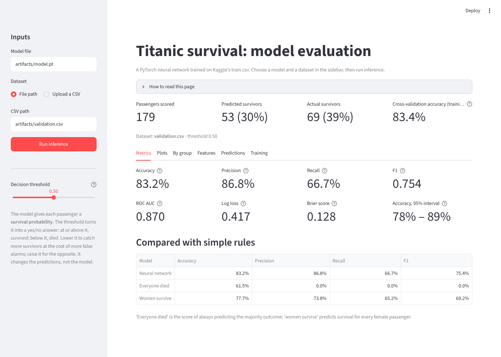
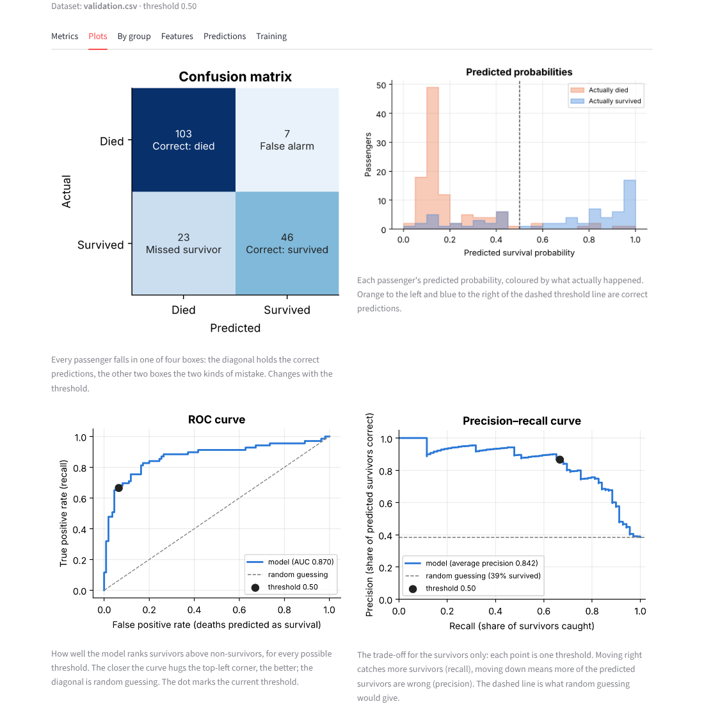
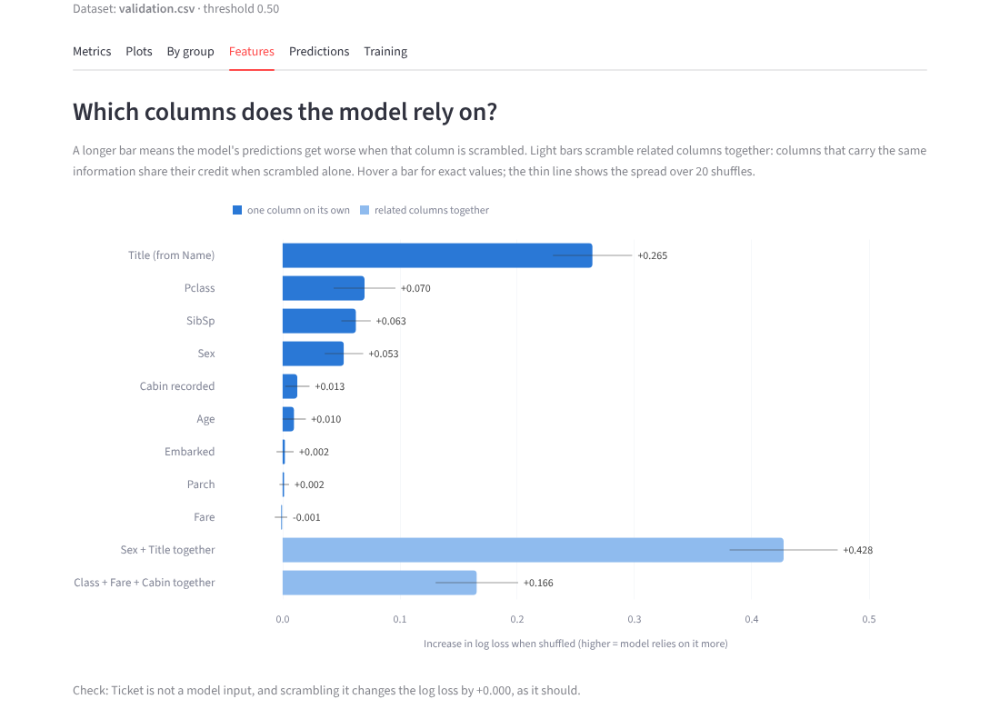

# Titanic survival: PyTorch classifier + Streamlit app

Predicts Titanic passenger survival from Kaggle's `train.csv`: EDA in a notebook, preprocessing based on it, a PyTorch neural network trained by `train.py`, and a Streamlit app (`ds_app.py`) that loads the saved model, scores a CSV and shows metrics and plots.

Only `train.csv` is used, split once into 712 training and 179 validation passengers (stratified, seed 42).

| | Accuracy | ROC AUC |
|---|---|---|
| 5-fold cross-validation (training split) | 83.4% ± 2.5% | 0.876 |
| **Validation split** | **83.2%** | **0.870** |
| Baseline: "women survive" | 77.7% | – |

## Setup instructions

- Python 3.10+ (CPU is enough).
- A Kaggle API token, to download the data:
  1. [kaggle.com/settings](https://www.kaggle.com/settings) → API → **Create New Token**.
  2. Accept the competition rules at [kaggle.com/competitions/titanic/rules](https://www.kaggle.com/competitions/titanic/rules).
  3. Copy `.env.example` to `.env` and paste the token after `KAGGLE_API_TOKEN=`. `.env` is git-ignored. (On Colab, use a secret named `KAGGLE_API_TOKEN` instead.)

A trained model is already in `artifacts/`, so the app works without a token.

## Installation commands

```bash
git clone https://github.com/hillysegal1/assignment.git
cd assignment
python -m venv .venv
source .venv/bin/activate          # Windows: .venv\Scripts\activate
pip install -r requirements.txt
cp .env.example .env               # Windows: copy .env.example .env, then add your token
```

## Run instructions

**Train the model**

```bash
python train.py                                # downloads train.csv from Kaggle
python train.py --data-path path/to/train.csv  # or use a local copy (no token needed)
```

It writes `artifacts/model.pt` (weights, network shape and fitted preprocessing), `artifacts/validation.csv` (the held-out passengers) and `artifacts/training_report.json`. `python train.py --help` lists further options.

**Run the app**

```bash
streamlit run ds_app.py
```

It opens at `http://localhost:8501`.

**EDA notebook**

```bash
jupyter notebook notebooks/eda.ipynb
```

## Example usage

1. Start the app. The sidebar is pre-filled with `artifacts/model.pt` and `artifacts/validation.csv`; enter any other model or CSV path, or upload a CSV.
2. Click **Run inference**.
3. Explore the tabs:
   - **Metrics:** accuracy, precision, recall, F1, ROC AUC, log loss, and a comparison with simple baselines.
   - **Plots:** confusion matrix, probability distribution, ROC and precision–recall curves, the threshold trade-off, calibration.
   - **By group:** results per sex and class.
   - **Features:** permutation importance, showing which columns the model relies on.
   - **Predictions:** a table per passenger, with a download button.
   - **Training:** the cross-validation learning curves.
4. Move the **decision threshold** slider to see the precision/recall trade-off.

Try `data/sample_unlabeled.csv` to see predictions without metrics. Wrong paths or missing columns show a clear message.







## Architecture and design choices

```
train.py            training script: data split, training loop, cross-validation, final fit, saving
ds_app.py           Streamlit app
src/titanic/        code shared by train.py and the app: data.py, preprocessing.py, model.py, checkpoint.py, evaluate.py
notebooks/eda.ipynb exploratory data analysis
artifacts/          trained model and validation split
data/               small sample CSVs (full data: Kaggle)
tests/              pytest checks
```

### Data flow

1. `train.py` downloads `train.csv` from Kaggle (token read from `.env`) and checks its columns and values.
2. It splits the 891 passengers once: 712 for training, 179 held out for validation (stratified, seed 42).
3. It runs cross-validation on the 712 training passengers to choose how long to train (below).
4. It fits the preprocessing and trains the final model on all 712, then saves the model, the fitted preprocessing and the validation passengers to `artifacts/`.
5. The app loads `artifacts/model.pt`, applies the saved preprocessing to whatever CSV it is given, and shows the results.

The validation passengers are never used for a decision: not in the EDA's survival analysis, not for the preprocessing statistics, not for choosing the model. They are scored once, at the end.

### Preprocessing

Every choice comes from the EDA:
- **Title:** extracted from Name. Mr, Mrs, Miss and Master are kept, and rare titles become Mr or Mrs by sex.
- **Age:** missing ages are filled with the median for the title, with Miss split by whether the passenger travels with parents or children (median age 8 vs 26).
- **Fare:** a fare of 0 is treated as missing, filled with the median for the class, then log-transformed.
- **Cabin:** reduced to a "recorded" flag.
- **Encoding:** class, port and title are one-hot encoded; the numeric columns are standardised.

The preprocessing has a `fit` step, run on training rows only, which learns the medians and scaling values. Its `transform` step applies those stored values to any data. The fitted values are saved inside the checkpoint, so the app transforms data exactly as training did.

### Model

A small fully connected network (MLP), 17 inputs → 32 → 16 → 1 output, with ReLU, dropout 0.2, AdamW (learning rate 0.001, weight decay 0.001), batches of 32, and `BCEWithLogitsLoss`.

It's kept small because there are only 712 training rows; it has 1,121 weights. The hidden layers let it learn interactions such as "class matters differently for men and women", which a linear model can't. I compared networks from 8 to 128 hidden units, and a logistic regression, with cross-validation. All the networks with a hidden layer scored within noise of each other, so the data, not the architecture, limits accuracy.

### Cross-validation: how long to train

A neural network improves for a while and then starts memorising the training passengers (overfitting), so the number of epochs has to be chosen. That choice can't use the validation split, or it would no longer be unseen. So it's made with 5-fold cross-validation on the 712 training passengers:

1. Split the training passengers into 5 stratified folds of about 142.
2. Train 5 times. Each time, one fold is held out, and the preprocessing is fitted and the model trained on the other four. After every epoch (up to 200), score the held-out fold.
3. Average the five held-out curves and pick the epoch with the lowest loss: **42**. Held-out loss stops improving around epoch 25 and rises after about 100, which is the overfitting this avoids.
4. Train the final model on all 712 passengers for 42 epochs.

Two details matter. The preprocessing is refitted inside every fold, so a held-out fold never contributes to its own filling values. And the choice uses log loss rather than accuracy, because log loss changes smoothly while accuracy jumps with every passenger crossing the threshold.

Cross-validation also gives an honest estimate before the validation split is touched: 83.4% ± 2.5% accuracy across folds. The validation score (83.2%) falls right inside that range.

### Reproducibility and robustness

- **Fixed seeds and deterministic PyTorch:** rerunning `train.py` produces identical weights.
- **Safe checkpoint:** it holds only tensors, numbers and strings, and loads with `torch.load(weights_only=True)`.
- **Clear errors:** bad paths, missing columns or a missing token produce a readable message, not a crash.
- **Tests:** `pytest` checks the preprocessing, the checkpoint and the app.

### Evaluation

The app reports metrics beyond accuracy (precision, recall, F1, ROC AUC, log loss), compares the model with simple baselines, and shows calibration, results per group and permutation feature importance. The model beats "women survive" (77.7%) mainly by getting boys and 3rd-class women right. It's weakest on 3rd-class women and 1st-class men, whose survival was close to a coin toss.
